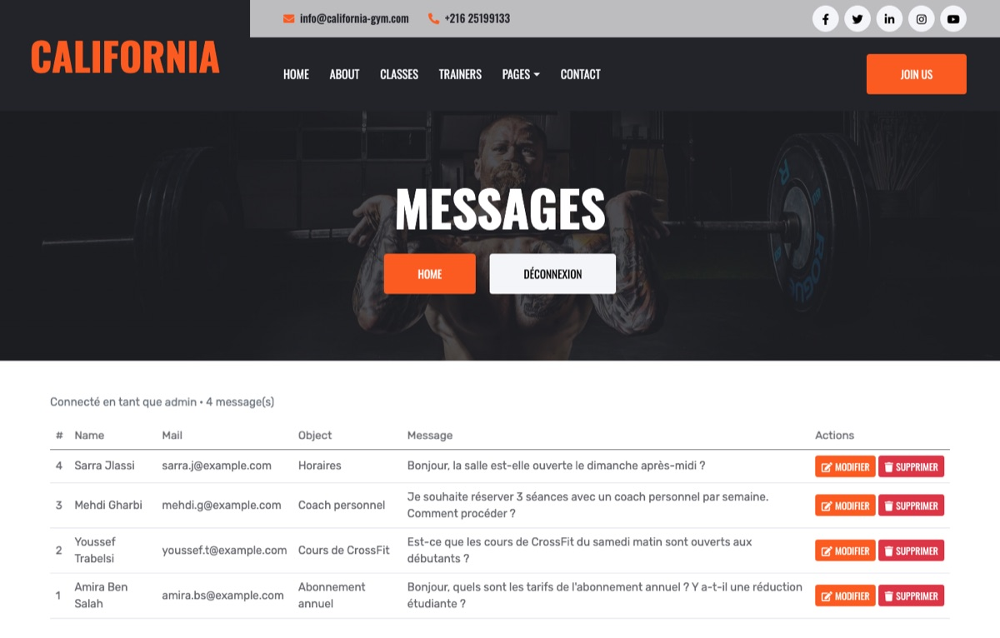
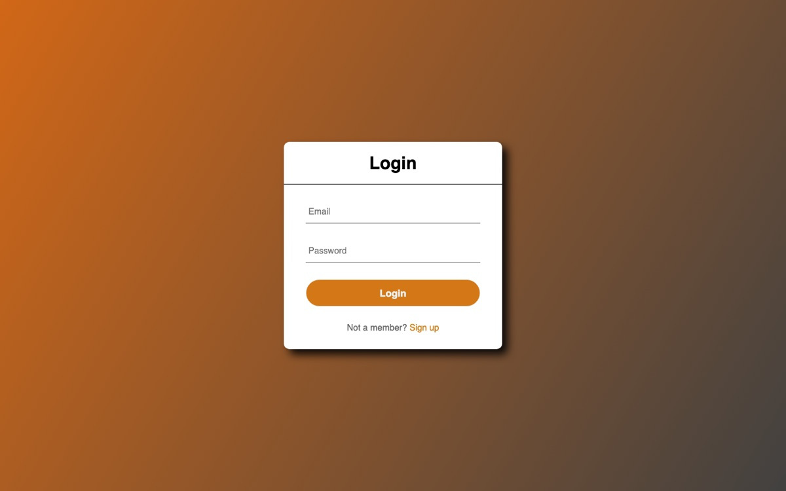
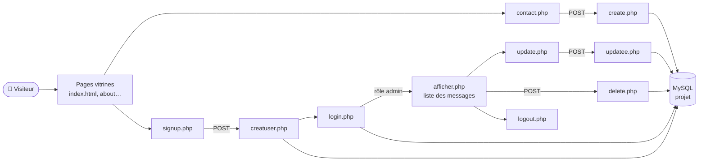

<div align="center">

# 🏋️ California Gym — Site web de salle de sport

**Site vitrine + espace membre pour une salle de sport à Sousse 🇹🇳 :**
**inscription, connexion, formulaire de contact et gestion des messages, en PHP / MySQL.**


<br>


</div>

---

## 📌 Sommaire

- [Fonctionnalités](#-fonctionnalités)
- [Aperçu](#-aperçu)
- [Stack technique](#️-stack-technique)
- [Installation](#-installation)
- [Fonctionnement](#-fonctionnement)
- [Base de données](#️-base-de-données)
- [Structure du projet](#-structure-du-projet)
- [Sécurité](#-sécurité)
- [Améliorations possibles](#️-améliorations-possibles)
- [Crédits](#-crédits)

---

## ✨ Fonctionnalités

| | Fonctionnalité | Détail |
|:--:|:--|:--|
| 🏠 | **Site vitrine** | Accueil, à propos, cours, planning, coachs, blog et témoignages |
| 📬 | **Formulaire de contact** | Les messages des visiteurs sont enregistrés en base de données |
| 📝 | **Inscription** | Création de compte avec validation et mot de passe chiffré |
| 🔐 | **Connexion / déconnexion** | Session sécurisée, messages d'erreur clairs |
| 👥 | **Rôles membre / admin** | Chaque inscrit est *membre*. Seuls les *admins* (le personnel de la salle) accèdent à la gestion |
| 🗂️ | **Espace administrateur** | Lister, **modifier** et **supprimer** les messages de contact (CRUD) |
| 📱 | **Responsive** | Mise en page adaptée au mobile, à la tablette et à l'ordinateur grâce à Bootstrap 5 |

## 📸 Aperçu

<table>
  <tr>
    <td width="60%"></td>
    <td width="40%"></td>
  </tr>
  <tr>
    <td align="center"><b>Espace admin</b> : modifier ou supprimer les messages</td>
    <td align="center"><b>Connexion</b> des membres</td>
  </tr>
</table>

## 🛠️ Stack technique

| Couche | Technologies |
|:--|:--|
| **Front-end** | HTML5, CSS3, Bootstrap 5, jQuery, Owl Carousel, Font Awesome, Bootstrap Icons |
| **Back-end** | PHP 8 (procédural, extension `mysqli` avec requêtes préparées) |
| **Base de données** | MySQL / MariaDB |
| **Environnement** | XAMPP (Apache + MariaDB + phpMyAdmin) |

## 🚀 Installation

### Avec XAMPP (recommandé)

1. **Cloner le projet** dans le dossier `htdocs` de XAMPP :

   ```bash
   # macOS : /Applications/XAMPP/xamppfiles/htdocs   ·   Windows : C:\xampp\htdocs
   cd /Applications/XAMPP/xamppfiles/htdocs
   git clone https://github.com/slimzrrk/salle_de_sport.git
   ```

2. **Démarrer Apache et MySQL** depuis le panneau de contrôle XAMPP.

3. **Importer la base de données** : ouvrez [phpMyAdmin](http://localhost/phpmyadmin), allez dans l'onglet **Importer** et choisissez `projet.sql`. Le fichier crée lui-même la base `projet`. En ligne de commande :

   ```bash
   mysql -u root < projet.sql
   ```

4. **Ouvrir le site** : 👉 [http://localhost/salle_de_sport/](http://localhost/salle_de_sport/)

5. **Créer le compte administrateur** : inscrivez-vous (**Join Us** → **Sign up**), puis donnez-vous le rôle admin dans phpMyAdmin (onglet SQL) :

   ```sql
   UPDATE user SET role = 'admin' WHERE email = 'votre@email.com';
   ```

   Le changement est immédiat, inutile de vous reconnecter. Ouvrez ensuite **Contact** → **Voir les messages reçus**.

### Sans Apache (serveur PHP intégré)

```bash
cd salle_de_sport
php -S localhost:8000      # puis ouvrir http://localhost:8000
```

### Configuration de la base

Par défaut, `config.php` utilise la configuration XAMPP : `localhost`, utilisateur `root` sans mot de passe, base `projet`. Chaque paramètre peut être remplacé par une variable d'environnement :

| Variable | Défaut |
|:--|:--|
| `DB_HOST` | `localhost` |
| `DB_PORT` | `3306` |
| `DB_USER` | `root` |
| `DB_PASS` | *(vide)* |
| `DB_NAME` | `projet` |

<details>
<summary><b>Vous aviez déjà importé une ancienne version de la base ?</b></summary>

Mettez la table `user` à jour : la colonne des mots de passe doit pouvoir contenir des hash, et il faut ajouter la colonne des rôles.

```sql
ALTER TABLE user MODIFY mdp VARCHAR(255) NOT NULL;
ALTER TABLE user ADD role ENUM('membre','admin') NOT NULL DEFAULT 'membre';
```

Les anciens comptes, dont le mot de passe était stocké en clair, continuent de fonctionner. Leur mot de passe est **chiffré automatiquement à la prochaine connexion**.

</details>

## 🧭 Fonctionnement



## 🗄️ Base de données

Base **`projet`**, deux tables :

| Table `user` | Type | | Table `contact` | Type |
|:--|:--|:--:|:--|:--|
| `id` 🔑 | `INT` auto-incrément | | `id` 🔑 | `INT` auto-incrément |
| `nom` | `VARCHAR(100)` | | `nom` | `VARCHAR(100)` |
| `email` | `VARCHAR(100)`, unique | | `email` | `VARCHAR(100)` |
| `mdp` | `VARCHAR(255)`, hash bcrypt | | `objet` | `VARCHAR(100)` |
| `role` | `ENUM('membre','admin')` | | `msg` | `VARCHAR(500)` |

## 📁 Structure du projet

```text
salle_de_sport/
├── index.html · about.html · class.html · team.html
├── blog.html · detail.html · testimonial.html   # Pages vitrines
├── contact.php          # Formulaire de contact
├── create.php           # → enregistre un message
├── signup.php           # Formulaire d'inscription
├── creatuser.php        # → crée le compte (mot de passe chiffré)
├── login.php            # Connexion
├── logout.php           # Déconnexion
├── afficher.php         # Liste des messages (administrateurs)
├── update.php           # Formulaire de modification
├── updatee.php          # → enregistre la modification
├── delete.php           # → supprime un message
├── config.php           # Connexion BDD, session, fonctions utilitaires
├── projet.sql           # Schéma de la base de données
├── css/ · js/ · scss/ · lib/ · img/
└── screenshots/         # Captures utilisées dans ce README
```

## 🔒 Sécurité

| Risque | Protection mise en place |
|:--|:--|
| 💉 Injection SQL | **Requêtes préparées** (`prepare` + `bind_param`) partout |
| 🔑 Vol de mots de passe | Mots de passe chiffrés avec **`password_hash()`** (bcrypt), jamais stockés en clair |
| 🧨 XSS (injection de scripts) | Tout affichage de données passe par `htmlspecialchars()` |
| 🚪 Accès non autorisé | Liste, modification et suppression des messages **réservées au rôle admin**. Le rôle est vérifié en base à chaque requête, et un membre reçoit une erreur 403 |
| 🍪 Fixation de session | `session_regenerate_id()` à la connexion et à la déconnexion |
| 🕵️ Énumération de comptes | Même message d'erreur que l'email soit inconnu ou le mot de passe faux |
| ✅ Données invalides | Validation côté serveur : champs requis, format d'email, longueurs maximales |

## 🛣️ Améliorations possibles

- [ ] **Gestion des comptes** depuis l'interface admin (promouvoir un membre sans passer par SQL).
- [ ] **Jetons CSRF** sur les formulaires de modification et de suppression.
- [ ] **Traduction complète en français**, car une partie des textes du template est en anglais.
- [ ] **Envoi d'un email** de confirmation au visiteur et de notification à la salle.
- [ ] **Pagination et recherche** dans la liste des messages.
- [ ] **Réservation de cours** en ligne pour les membres.
- [ ] **Docker Compose** pour lancer le projet en une commande.

## 🙏 Crédits

- Design basé sur le template **[GYMSTER](https://htmlcodex.com/gym-html-template)** de **[HTML Codex](https://htmlcodex.com)**, sous licence [CC BY 4.0](https://creativecommons.org/licenses/by/4.0/). La licence impose de conserver le lien de crédit vers l'auteur.
- Photos et icônes : celles fournies avec le template, et [Flaticon](https://www.flaticon.com).

---

<div align="center">

Réalisé par **[@slimzrrk](https://github.com/slimzrrk)** · ⭐ Si ce projet vous plaît, n'hésitez pas à lui donner une étoile !

</div>
